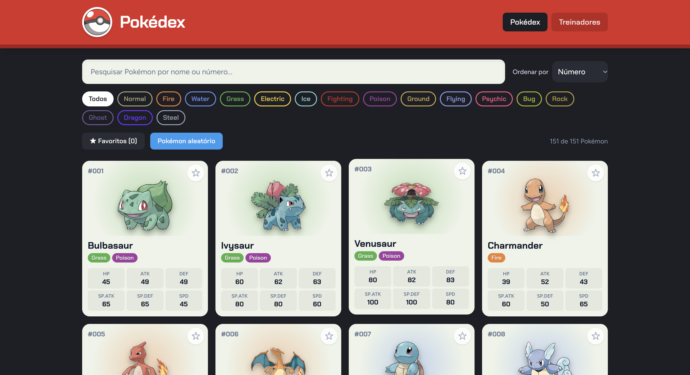
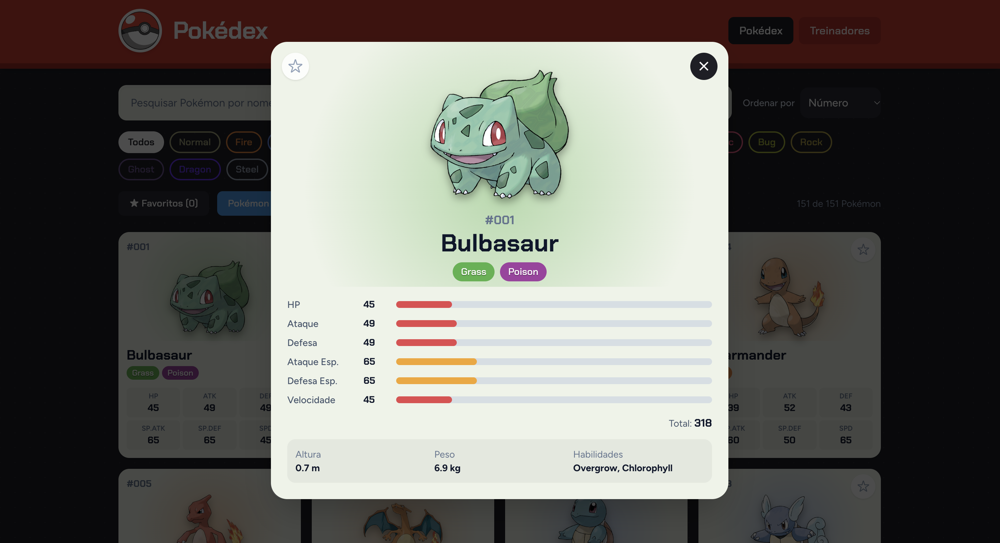
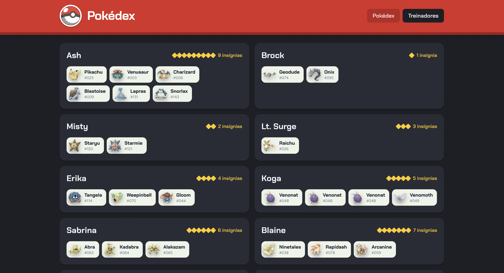
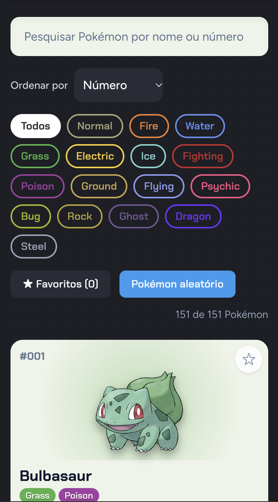

# Pokédex

**Consulte os 151 Pokémon originais, compare atributos, explore treinadores e monte sua lista de favoritos em uma interface rápida e responsiva.**

[](#-status-do-projeto)


</div>

---

## 📚 Índice

- [Sobre o Projeto](#-sobre-o-projeto)
- [Funcionalidades Principais](#-funcionalidades-principais)
- [Tecnologias Utilizadas](#-tecnologias-utilizadas)
- [Arquitetura](#-arquitetura)
- [Instalação e Execução](#-instalação-e-execução)
- [Estrutura de Pastas](#-estrutura-de-pastas)
- [Demonstração](#-demonstração)
- [Documentações utilizadas](#-documentações-utilizadas)
- [Autor](#-autor)

---

## 📝 Sobre o Projeto

A **Pokédex React** é uma aplicação web de página única (SPA) para consultar Pokémon de forma rápida. Ela reúne, em uma só tela, tudo o que normalmente exige várias abas abertas: busca, filtro por tipo, atributos de combate, detalhes de cada criatura e o time de cada treinador.

**Como funciona:** os dados principais (151 Pokémon, 18 tipos e 12 treinadores) ficam em um arquivo JSON local, então a Pokédex abre e funciona mesmo sem internet. A [PokéAPI](https://pokeapi.co/) entra como complemento opcional: fornece as artes oficiais e, no modal de detalhes, altura, peso e habilidades.

**Identidade visual:** a interface imita o aparelho da Pokédex, com corpo vermelho, lente azul, luzes de status e uma "tela" clara para o conteúdo. Cada card recebe um brilho na cor do tipo principal do Pokémon.

---

## ✨ Funcionalidades Principais

- 🐾 **Catálogo completo:** os 151 Pokémon com número, nome, tipos e os 6 atributos (HP, Ataque, Defesa, Ataque Esp., Defesa Esp. e Velocidade) direto no card.
- 🔎 **Pesquisa instantânea:** por nome ou número, atualizando a lista a cada tecla. Aceita `25`, `025` e `#025`, e ignora acentos e maiúsculas.
- 🧬 **Filtro por tipo:** botões coloridos gerados a partir dos tipos presentes nos dados.
- 📄 **Detalhes do Pokémon:** modal com arte oficial, barras de atributos, total de pontos e dados extras da PokéAPI. Fecha com `Esc`, clique fora ou no botão ✕.
- 🧑‍🚀 **Treinadores:** nome, quantidade de insígnias e time de cada um; clicar em um Pokémon do time abre seus detalhes.
- ⭐ **Favoritos:** marque Pokémon e filtre só por eles. A lista fica salva no navegador (`localStorage`).
- 📊 **Ordenação:** por número, nome ou qualquer um dos 6 atributos.
- 🎲 **Pokémon aleatório:** abre os detalhes de um Pokémon sorteado.
- 🚫 **Estado vazio:** mensagem clara e botão "Limpar filtros" quando nenhuma busca retorna resultado.
- 📱 **Responsivo:** de 1 coluna no celular até 4 colunas no desktop.
- ♿ **Acessível:** foco visível, navegação por teclado, rótulos para leitores de tela e respeito a `prefers-reduced-motion`.
- 🛟 **Resiliente:** se uma imagem ou a PokéAPI falhar, a aplicação continua funcionando (Poké Bola de fallback e mensagem discreta).

---

## 🛠 Tecnologias Utilizadas

| Camada | Tecnologia | Versão |
| :--- | :--- | :--- |
| Biblioteca de UI | [React](https://react.dev/) | 19 |
| Build tool / servidor de desenvolvimento | [Vite](https://vite.dev/) | 8 |
| Estilização | [Tailwind CSS](https://tailwindcss.com/) (via plugin `@tailwindcss/vite`) | 4 |
| Linguagem | JavaScript (ES2022, JSX) | — |
| Qualidade de código | [ESLint](https://eslint.org/) com `react-hooks` e `react-refresh` | 10 |
| Tipografia | [Chakra Petch](https://fonts.google.com/specimen/Chakra+Petch) (títulos) e [Figtree](https://fonts.google.com/specimen/Figtree) (texto) | — |
| Dados | Arquivo local `pokedex-data.json` | — |
| Dados complementares (opcional) | [PokéAPI](https://pokeapi.com/) | v2 |

> **Requisito de ambiente:** Node.js **20.19+** ou **22.12+** (exigência do Vite 8).

---

## 🏗 Arquitetura

A aplicação é **100% front-end**, sem backend. O `App.jsx` concentra o estado e distribui dados e funções para componentes de apresentação por meio de **props**.

### Árvore de componentes

```text
App
 ├── Header                 (navegação: Pokédex | Treinadores)
 ├── [view = "dex"]
 │    ├── SearchBar
 │    ├── TypeFilter
 │    ├── PokemonList
 │    │    └── PokemonCard   (× N)
 │    │         ├── PokemonImage
 │    │         └── TypeBadge
 │    └── EmptyState         (quando não há resultados)
 ├── [view = "trainers"]
 │    └── TrainerList
 │         └── PokemonImage
 └── PokemonDetails          (modal)
      ├── PokemonImage
      ├── TypeBadge
      └── StatBar            (× 6)
```

### Fluxo de dados

1. `utils/pokemon.js` importa o JSON e exporta os dados, as cores dos tipos e as funções de busca e ordenação.
2. `App.jsx` guarda o estado da interface: seção ativa, texto da busca, tipo ativo, ordenação, filtro de favoritos, lista de favoritos e Pokémon selecionado.
3. A lista exibida é um **estado derivado**: um `useMemo` aplica busca, tipo, favoritos e ordenação sobre os 151 Pokémon, sem duplicar dados em estado.
4. Os componentes filhos disparam eventos (`onSelect`, `onToggleFavorite`, `onChange`) e o `App` atualiza o estado.
5. O modal usa um hook próprio, `usePokeApiInfo`, que busca dados extras com `useEffect` e `AbortController`, cancelando a requisição ao fechar.

### Decisões e trade-offs

- **Sem biblioteca de estado global:** com poucos estados compartilhados, `useState` no `App` é suficiente e mais simples de ler.
- **Dados locais como fonte principal:** garante funcionamento offline; a PokéAPI só complementa.
- **Sem roteador:** a troca entre Pokédex e Treinadores é um estado simples. O trade-off é que a seção não aparece na URL, então não dá para compartilhar um link direto para ela.
- **Imagens por URL derivada do ID:** evita uma chamada de API por card (151 requisições) e usa o repositório de sprites da PokéAPI.

---

## 🔧 Instalação e Execução

### Pré-requisitos

- **Node.js** 20.19+ ou 22.12+
- **npm** (já vem com o Node.js)
- **Git**

Não é necessário criar arquivos `.env`: o projeto não usa variáveis de ambiente nem chaves de API.

### Passo a passo

1. **Clone o repositório e entre na pasta do projeto:**

```bash
git clone https://github.com/PauloCesar0709/desenvolvimento-e-integracao-de-aplicacoes-web.git
cd desenvolvimento-e-integracao-de-aplicacoes-web/pokedex
```

2. **Instale as dependências:**

```bash
npm install
```

3. **Inicie o servidor de desenvolvimento:**

```bash
npm run dev
```

🎨 *A aplicação estará disponível em **http://localhost:5173**.*

### Scripts disponíveis

| Comando | O que faz |
| :--- | :--- |
| `npm run dev` | Inicia o servidor de desenvolvimento com hot reload |
| `npm run lint` | Analisa o código com o ESLint |
| `npm run build` | Gera o build de produção na pasta `dist/` |
| `npm run preview` | Serve localmente o build de produção |

---

## 📂 Estrutura de Pastas

```text
pokedex-react/
├── public/images
│   ├── Pokedex.png              # 🖼️ Imagem da Pokedex do cabeçalho
├── docs/
│   └── images/             # 📸 Capturas de tela usadas neste README
├── src/
│   ├── components/              # 🧱 Componentes de interface
│   │   ├── Header.jsx           #    Lente, luzes e navegação entre seções
│   │   ├── SearchBar.jsx        #    Campo de pesquisa
│   │   ├── TypeFilter.jsx       #    Filtro por tipo
│   │   ├── PokemonList.jsx      #    Grade de cards (renderização com map)
│   │   ├── PokemonCard.jsx      #    Card com atributos e botão de favorito
│   │   ├── PokemonDetails.jsx   #    Modal de detalhes + hook usePokeApiInfo
│   │   ├── PokemonImage.jsx     #    Imagem com fallback em SVG
│   │   ├── StatBar.jsx          #    Barra de atributo
│   │   ├── TypeBadge.jsx        #    Etiqueta colorida de tipo
│   │   ├── TrainerList.jsx      #    Treinadores e seus times
│   │   └── EmptyState.jsx       #    Mensagem de nenhum resultado
│   ├── data/
│   │   └── pokedex-data.json    # 🐾 Pokémon, tipos e treinadores
│   ├── utils/
│   │   └── pokemon.js           # 🛠️ Cores, busca, ordenação e URLs de imagens
│   ├── App.jsx                  # 🧠 Estado global da interface e composição
│   ├── main.jsx                 # 🚪 Ponto de entrada
│   └── index.css                # 🎨 Tailwind + tema (paleta da Pokédex)
├── eslint.config.js             # ✨ Regras do ESLint
├── index.html                   # 📄 Documento HTML base
├── vite.config.js               # ⚡ Configuração do Vite + Tailwind
├── package.json                 # 📦 Dependências e scripts
└── README.md                    # 📘 Este arquivo
```

### 🎨 Paleta de cores

| Cor | Hex | Uso |
| :--- | :--- | :--- |
| Vermelho Pokédex | `#d92d27` | Cabeçalho |
| Carcaça | `#1e1f26` | Fundo da página |
| Painel | `#2a2c36` | Botões e cartões escuros |
| Tela | `#eef3e8` | Cards e modal |
| Lente | `#2f9bf0` | Destaques e barras de atributo altas |
| Amarelo | `#ffcb05` | Foco, favoritos ativos e insígnias |

---

## 🎥 Demonstração

| Tela | Captura |
| :---: | :---: |
| **Pokédex (lista, busca e filtros)** | **Detalhes do Pokémon (modal)** |
|  |  |
| **Treinadores** | **Versão mobile** |
|  |  |

---

## 🔗 Documentações utilizadas

- 📖 **React:** [react.dev/reference/react](https://react.dev/reference/react)
- 📖 **Vite:** [vite.dev/config](https://vite.dev/config/)
- 📖 **Tailwind CSS v4:** [tailwindcss.com/docs](https://tailwindcss.com/docs)
- 📖 **ESLint:** [eslint.org/docs](https://eslint.org/docs/latest/)
- 📖 **PokéAPI:** [pokeapi.co/docs/v2](https://pokeapi.co/docs/v2) — consulta de altura, peso e habilidades
- 📖 **PokéAPI Sprites:** [github.com/PokeAPI/sprites](https://github.com/PokeAPI/sprites) — artes oficiais dos Pokémon

> ⚠️ Pokémon e seus personagens são marcas registradas da Nintendo, Creatures Inc. e Game Freak. Este é um projeto sem fins lucrativos, feito para estudo e demonstração.

---

## 👥 Autor

| 👤 Nome | :octocat: GitHub | 💼 LinkedIn |
| :--- | :---: | :---: | :---: |
| **Paulo Cesar** | [GitHub](https://github.com/PauloCesar0709) | [LinkedIn](https://www.linkedin.com/in/paulo-césar-desenvolvedor) |

---
